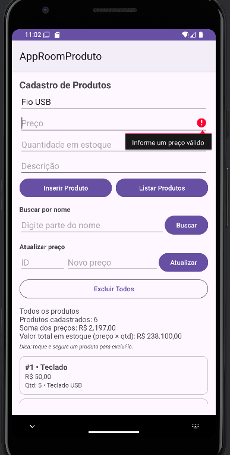
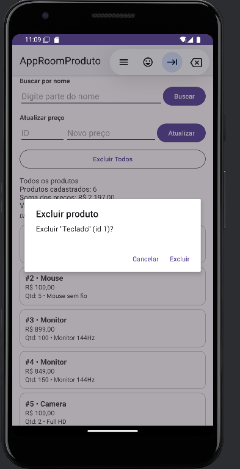
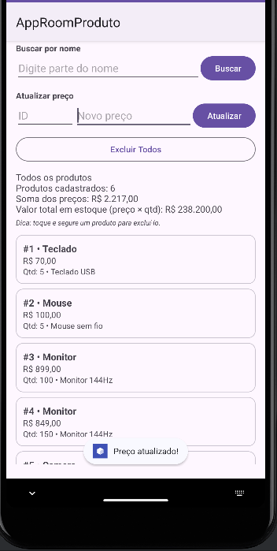

# AppRoomProduto: Cadastro de Produtos com Room SQLite

**Alunos:**
- Bruno Barros, RA 131037
- Matheus Siani, RA 101063

**Disciplina:** Programação para Dispositivos Móveis  
**Professor(a):** Nome do Professor

## Sobre o projeto

Aplicativo Android em Kotlin que cadastra, lista, busca, atualiza e exclui produtos usando persistência local com Room (SQLite). Além do tutorial base, foram implementados todos os itens da Parte A, incluindo os desafios extras (RecyclerView e exclusão de um produto específico com `@Delete`), e o banco foi organizado como Singleton.

## Tecnologias

- Kotlin
- Room 2.6.1 (SQLite)
- ViewBinding
- Corrotinas (lifecycleScope)
- RecyclerView + ListAdapter/DiffUtil
- Material Components

## Estrutura

```
app/src/main/java/br/unimes/approomproduto/
├── model/Product.kt          ← entidade (tabela product)
├── dao/ProductDao.kt         ← comandos do banco
├── db/AppDatabase.kt         ← banco de dados (Singleton)
└── view/
    ├── MainActivity.kt       ← tela e regras
    └── ProductAdapter.kt     ← adapter do RecyclerView
```

## Prints do app


## Parte A: Complemento prático

### A1. Limpar campos após inserir

**O que foi feito:** depois que o produto é gravado com sucesso, a função `limparCampos()` apaga o texto dos campos (Nome, Preço, Quantidade e Descrição) e devolve o cursor para o campo Nome com `requestFocus()`. Ela é chamada dentro da corrotina, logo após o `insertAll`, para garantir que os campos só sejam limpos quando a inserção realmente terminou.

```kotlin
private fun limparCampos() {
    binding.editProductName.text.clear()
    binding.editProductPrice.text.clear()
    binding.editProductQuantity.text.clear()
    binding.editProductDescription.text.clear()
    binding.editProductName.requestFocus()
}
```

Print: 

### A2. Validação de preço

**O que foi feito:** o texto do preço é convertido com `toDoubleOrNull()` (aceitando vírgula ou ponto). Se o valor for nulo (vazio ou inválido), zero ou negativo, o produto não é salvo e o erro aparece no próprio campo. O nome também é validado da mesma forma.

```kotlin
val price = binding.editProductPrice.text.toString().replace(',', '.').toDoubleOrNull()

if (price == null || price <= 0.0) {
    binding.editProductPrice.error = "Informe um preço válido"
    binding.editProductPrice.requestFocus()
    return
}
```

Print: 

### A3. Lista na tela (desafio extra: RecyclerView)

**O que foi feito:** em vez de mostrar os produtos só no Logcat, a lista aparece na tela em um `RecyclerView` (desafio extra), com um card para cada produto exibindo id, nome, preço formatado em reais, quantidade e descrição. O adapter usa `ListAdapter` com `DiffUtil`, que atualiza apenas os itens que mudaram. Logo acima da lista há um `TextView` (`txtResumo`) com o resumo. O Logcat continua sendo usado também.

```kotlin
adapter = ProductAdapter { product -> confirmarExclusao(product) }
binding.recyclerProdutos.layoutManager = LinearLayoutManager(this)
binding.recyclerProdutos.adapter = adapter

private fun listarProdutos() {
    lifecycleScope.launch {
        val products = productDao.getAll()
        mostrarProdutos(products, "Todos os produtos")
    }
}
```

Print: 

### A4. Total do estoque

**O que foi feito:** junto da lista, o `txtResumo` mostra a quantidade de produtos (`products.size`) e a soma dos preços (`products.sumOf { it.price }`). Como o item A8 adicionou a quantidade em estoque, também foi incluído o valor total do estoque (preço × quantidade).

```kotlin
val quantidadeProdutos = products.size
val somaPrecos = products.sumOf { it.price }
val valorEstoque = products.sumOf { it.price * it.quantity }

binding.txtResumo.text = buildString {
    appendLine(titulo)
    appendLine("Produtos cadastrados: $quantidadeProdutos")
    appendLine("Soma dos preços: ${moeda.format(somaPrecos)}")
    append("Valor total em estoque (preço × qtd): ${moeda.format(valorEstoque)}")
}
```

Print: 

### A5. Buscar por nome

**O que foi feito:** foi criada no DAO a função `buscarPorNome` com `LIKE`, além de um campo de busca e o botão **Buscar**. O texto digitado é envolvido em `%` (`"%$texto%"`), então buscar "tec" encontra "Teclado". Se o campo de busca estiver vazio, o app lista todos os produtos.

```kotlin
// ProductDao.kt
@Query("SELECT * FROM product WHERE name LIKE :nome")
suspend fun buscarPorNome(nome: String): List<Product>

// MainActivity.kt
lifecycleScope.launch {
    val encontrados = productDao.buscarPorNome("%$texto%")
    mostrarProdutos(encontrados, "Resultado da busca por \"$texto\"")
}
```

Print: 

### A6. Excluir produtos (desafio extra: excluir pelo id com @Delete)

**O que foi feito:** o botão **Excluir Todos** chama `deleteAll()` depois de uma confirmação em `AlertDialog`, para evitar exclusões acidentais. No desafio extra, ao tocar e segurar um item da lista, o app pergunta se deseja excluir aquele produto e chama `delete(product)`, anotado com `@Delete`. O Room usa a chave primária (`id`) do objeto para saber qual linha apagar.

```kotlin
// ProductDao.kt
@Query("DELETE FROM product")
suspend fun deleteAll()

@Delete
suspend fun delete(product: Product)

// MainActivity.kt (toque longo em um item)
lifecycleScope.launch {
    productDao.delete(product)
    listarProdutos()
}
```

Excluir um produto específico (toque longo no item):



Excluir todos os produtos:


### A7. Atualizar produto

**O que foi feito:** o usuário informa o **ID** e o **novo preço** e clica em **Atualizar**. O app busca o produto com `getById`, cria uma cópia com o novo preço usando `copy()` (a data class é imutável) e grava com `@Update`. Se o id não existir, aparece o erro "Produto não encontrado" no campo.

```kotlin
// ProductDao.kt
@Query("SELECT * FROM product WHERE id = :id")
suspend fun getById(id: Int): Product?

@Update
suspend fun update(product: Product)

// MainActivity.kt
lifecycleScope.launch {
    val produto = productDao.getById(id)
    if (produto == null) {
        binding.editUpdateId.error = "Produto não encontrado"
        return@launch
    }
    productDao.update(produto.copy(price = novoPreco))
    listarProdutos()
}
```

Print: 

### A8. Novo campo na tabela (quantity)

**O que foi feito:** a entidade `Product` ganhou o atributo `quantity: Int` (quantidade em estoque), o layout ganhou o campo "Quantidade em estoque" e a `version` do `@Database` foi de **1 para 2**.

```kotlin
// Product.kt
@ColumnInfo(name = "quantity") val quantity: Int = 0

// AppDatabase.kt
@Database(entities = [Product::class], version = 2)
```

**O que aconteceu com os produtos já cadastrados e por quê:** ao abrir o app depois da mudança, **todos os produtos cadastrados antes sumiram**. Isso acontece porque o Room percebe que a estrutura da tabela mudou (nova coluna) e que a versão do banco passou de 1 para 2. Como não foi criada nenhuma `Migration` dizendo como transformar a tabela antiga na nova, o `fallbackToDestructiveMigration()` entra em ação: ele apaga o banco antigo e cria um novo, vazio, já com a coluna `quantity`. Se a versão não fosse aumentada, o app fecharia com erro, porque o Room detectaria que o esquema não bate com o que estava salvo. Para manter os dados, seria preciso escrever uma migração, por exemplo:

```kotlin
val MIGRATION_1_2 = object : Migration(1, 2) {
    override fun migrate(db: SupportSQLiteDatabase) {
        db.execSQL("ALTER TABLE product ADD COLUMN quantity INTEGER NOT NULL DEFAULT 0")
    }
}
// .addMigrations(MIGRATION_1_2) no databaseBuilder
```

Print: 

## Parte B: Questões dissertativas

### B1. O que é persistência de dados? O que aconteceria se os produtos fossem guardados apenas em uma MutableList?

**Resposta:** Persistência de dados é a capacidade de guardar informações de forma que elas continuem existindo depois que o programa é fechado, o celular é reiniciado ou o sistema mata o processo do app. No meu projeto, os produtos são gravados em um arquivo SQLite (`database-name`) no armazenamento interno do aparelho, então ao fechar e abrir o app de novo e clicar em Listar Produtos, eles ainda aparecem. Se os produtos ficassem apenas em uma `MutableList` dentro da `MainActivity`, eles estariam só na memória RAM, ligados ao ciclo de vida daquele objeto. Bastaria fechar o app, o Android encerrar o processo para liberar memória ou até girar a tela (o que recria a Activity) para a lista ser perdida. Ou seja, a lista funcionaria como um rascunho temporário, enquanto o Room funciona como um caderno que fica guardado.

### B2. Qual é a diferença entre usar o SQLite diretamente e usar o Room? Cite pelo menos duas vantagens do Room.

**Resposta:** Usando o SQLite diretamente com `SQLiteOpenHelper`, o desenvolvedor precisa escrever na mão o `CREATE TABLE`, os comandos de inserção e consulta, abrir e fechar o banco e converter cada linha do `Cursor` em objeto, lendo coluna por coluna. É muito código repetitivo e fácil de errar. O Room é uma camada de abstração sobre o próprio SQLite: eu descrevo a tabela com uma data class (`Product`) e os comandos com anotações no `ProductDao`, e o Room gera o código pesado na compilação, via kapt. A primeira vantagem é a **verificação das consultas em tempo de compilação**: se eu escrever errado o nome de uma tabela ou coluna em um `@Query`, o projeto nem compila, em vez de quebrar só quando o usuário clicar no botão. A segunda é o **mapeamento automático para objetos**: `getAll()` já devolve `List<Product>`, sem precisar percorrer `Cursor`. Também há suporte nativo a corrotinas (`suspend`), menos código repetitivo e um sistema organizado de versões e migrações.

### B3. Explique o papel de Entity, DAO e Database. Como elas se relacionam no seu projeto?

**Resposta:** A **Entity** é a classe que representa uma tabela; no projeto é a `Product`, anotada com `@Entity`, em que cada atributo (`id`, `name`, `price`, `description`, `quantity`) vira uma coluna e o `id` é a chave primária gerada automaticamente. O **DAO** (Data Access Object) é a interface `ProductDao`, onde ficam as operações permitidas sobre a tabela: `getAll`, `insertAll`, `buscarPorNome`, `deleteAll`, `delete`, `getById` e `update`. O **Database** é a classe abstrata `AppDatabase`, anotada com `@Database`, que lista as entidades (`entities = [Product::class]`), define a versão do esquema e expõe os DAOs (`productDao()`). A relação é em cadeia: a `MainActivity` pede o banco ao `AppDatabase`, pede a ele o `ProductDao`, e o DAO lê e grava objetos `Product` na tabela `product`. A tela nunca fala com o SQLite diretamente, só com o DAO.

### B4. Por que o Android não permite acessar o banco na thread principal? O que é um ANR? Como suspend e lifecycleScope.launch resolvem isso?

**Resposta:** A thread principal (UI thread) é responsável por desenhar a tela e responder aos toques do usuário. Acessar o banco envolve leitura e escrita em disco, que pode demorar, principalmente com muitos dados ou em aparelhos mais lentos. Se isso acontecer na thread principal, a tela congela enquanto a operação não termina. Quando o app fica cerca de 5 segundos sem responder a um evento de entrada, o Android mostra um **ANR (Application Not Responding)**, a janela que pergunta se o usuário quer esperar ou fechar o app. Por isso o Room, por padrão, lança a exceção "Cannot access database on the main thread". No meu projeto, as funções do DAO são `suspend`, então o Room executa a consulta em uma thread de segundo plano e devolve o resultado sem bloquear a tela. Como função `suspend` só pode ser chamada dentro de uma corrotina, uso `lifecycleScope.launch { }`, que abre uma corrotina ligada ao ciclo de vida da Activity: ela é cancelada automaticamente se a Activity for destruída, evitando vazamentos. Depois do `await` interno, o código volta para a main thread, por isso posso atualizar o `RecyclerView` e mostrar o `Toast` direto ali dentro.

### B5. O que faz o fallbackToDestructiveMigration()? Por que é perigoso na Play Store? O que é uma Migration?

**Resposta:** O `fallbackToDestructiveMigration()` diz ao Room: "se a versão do banco mudar e não houver uma migração definida, apague tudo e recrie o banco do zero". Durante o desenvolvimento isso é prático, porque posso mudar a entidade à vontade sem o app quebrar, e foi exatamente o que aconteceu no item A8, quando os produtos antigos foram apagados ao subir a versão para 2. Em um app publicado na Play Store, isso é perigoso porque o usuário perderia todos os dados dele (cadastros, histórico, configurações) só por atualizar o aplicativo, sem aviso e sem chance de recuperação. Uma **Migration** é um código que ensina o Room a transformar o banco de uma versão para outra preservando os dados, normalmente com comandos SQL como `ALTER TABLE product ADD COLUMN quantity INTEGER NOT NULL DEFAULT 0`. Ela é criada com `Migration(1, 2)` e registrada no builder com `.addMigrations(...)`, garantindo que a atualização mude a estrutura sem perder nenhum produto.

### B6. Qual é a vantagem do ViewBinding em relação ao findViewById? Que tipo de erro ele ajuda a evitar?

**Resposta:** Com `findViewById`, eu preciso buscar cada componente pelo id e muitas vezes indicar o tipo manualmente, como `findViewById<EditText>(R.id.editProductName)`. Se eu passar um id que não existe naquele layout ou indicar o tipo errado, o código compila normalmente, mas o app quebra em tempo de execução com `NullPointerException` ou `ClassCastException`. O ViewBinding gera automaticamente uma classe para cada layout (`ActivityMainBinding` e `ItemProductBinding` no projeto), com uma propriedade para cada view que tem id, já com o tipo correto. Assim, `binding.editProductPrice` é garantidamente um `EditText` que existe naquela tela. Ele evita erros de **null safety** (acessar view inexistente) e de **type safety** (tipo errado), além de deixar o código mais limpo e transferir esses erros para a compilação, onde é muito mais fácil corrigir.

### B7. Por que em apps maiores o banco deve ser Singleton? O que aconteceria se várias telas criassem cada uma o seu banco?

**Resposta:** Criar uma instância do `RoomDatabase` é uma operação cara: abre o arquivo do banco, valida o esquema e aloca recursos. Em um app com várias telas, se cada uma chamasse `Room.databaseBuilder(...)`, haveria várias conexões abertas para o mesmo arquivo, gastando memória sem necessidade, e um risco real de inconsistência: uma instância poderia ter dados em cache diferentes da outra, e escritas simultâneas poderiam gerar conflitos de travamento (database locked). Além disso, observadores como `Flow` e `LiveData` de uma instância não seriam avisados de mudanças feitas por outra. Por isso, no meu projeto, o `AppDatabase` tem um `companion object` com `getDatabase(context)`, que cria o banco só na primeira chamada e devolve sempre a mesma instância depois. O `@Volatile` e o `synchronized` evitam que duas threads criem o banco ao mesmo tempo, e o uso de `applicationContext` evita vazar a Activity da memória.

### B8. Reflexão pessoal: dificuldades e um app real em que o Room seria útil

**Resposta:** A principal dificuldade foi entender por que o app fechava ao acessar o banco sem `suspend`; depois de ler o erro "Cannot access database on the main thread" ficou claro que precisava de corrotinas e do `lifecycleScope`. Também precisei prestar atenção na configuração do Gradle (plugin `kotlin-kapt` e `viewBinding = true`), porque, sem o Sync, a classe `ActivityMainBinding` não era gerada. No item A8, entendi na prática o efeito do `fallbackToDestructiveMigration()` ao ver os produtos antigos sumirem. Um app real em que o Room seria muito útil é um aplicativo de **controle de estoque para um almoxarifado ou pequena loja**: o funcionário registra entradas e saídas de produtos no celular mesmo em locais sem internet, como depósitos. Eu aplicaria uma entidade `Product` parecida com a deste projeto, outra entidade `Movimentacao` (entrada ou saída, data, quantidade) ligada ao produto, consultas para alertar estoque baixo (`WHERE quantity < minimo`) e, quando houvesse conexão, uma sincronização com o servidor, usando o Room como cache local confiável.

## Como executar

1. Clone o repositório
2. Abra no Android Studio
3. Aguarde o Gradle sincronizar
4. Execute em um emulador (API 24+)
5. No Logcat, use o filtro `tag:TAG` para ver os registros
